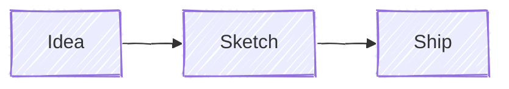
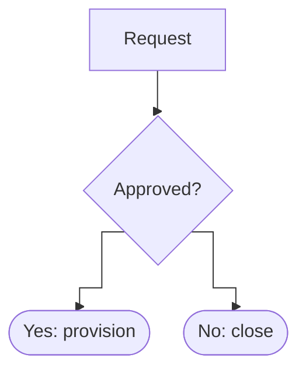

# Looks and layout

Verified on Obsidian 1.14.4 (mermaid 11.13.0) on 2026-10-19. Pele ignores `look` and `layout` and draws everything with its own layout engine and one clean style, so treat these options as decoration that quietly disappears after the switch.

## look (mermaid.js only)

| look | Effect | Status in Obsidian 1.14.4 |
|---|---|---|
| `classic` | The default | ✓ |
| `handDrawn` | Sketchy rough.js strokes and fills | ✓ renders; dark-mode inversion works fine on it |
| `neo` | Modern: softer shapes, lighter strokes | ✓ renders |

It applies to flowcharts and state diagrams, and most other types ignore it. Set it per diagram, because Obsidian has no global Mermaid config:

`handDrawnSeed` fixes the randomness so the sketch doesn't change between renders. When adding a look, tell the user it stops showing once Obsidian moves to Pele.

## layout

- `dagre` is the default and the only layout Obsidian ships.
- `layout: elk` has **no effect** in Obsidian 1.14.4: no ELK loader is bundled, so it silently falls back to dagre (identical output, verified). Don't promise ELK.
- Pele ignores `layout` and uses its own engine. Node positions and edge paths differ from Mermaid's, but the meaning doesn't.

## direction

- flowchart: `flowchart TB|TD|BT|LR|RL`.
- state, class and ER: a `direction LR` line.
- Subgraphs can set their own `direction`. Mermaid ignores it when a subgraph's nodes link outside it; Pele keeps it.
- **Narrow screens under Pele:** a wide `LR` layout may redraw top-down when the container is under about 640px (Obsidian controls this). On a phone, prefer `TD` for long chains.

## Curves (both engines)

- `config: flowchart: curve: …` accepts `basis` (default), `linear`, `step`, `stepBefore`, `stepAfter`, `monotoneX`, `monotoneY`, `natural`, `cardinal`, `catmullRom`, `bumpX`, `bumpY`. Pele maps `step*` to orthogonal lines, `linear` to straight lines, and the rest to smooth curves.
- Per edge: `linkStyle 0 interpolate linear`, or an edge id with `A e1@--> B` then `e1@{ curve: linear }`.
- Animated edges: `e1@{ animate: true }`. This works on 11.13 and Pele supports it.

## Spacing, wrapping and size (both engines)

- `flowchart.nodeSpacing`, `rankSpacing`, `wrappingWidth`; `state.nodeSpacing`, `rankSpacing`; `er.nodeSpacing`, `rankSpacing`; `class.nodeSpacing`, `rankSpacing`.
- `<type>.useMaxWidth: false` gives a fixed pixel size instead of shrinking to fit. Pele is responsive by default.
- If it's too wide, try a different `direction`, shorter labels with ` `, or splitting the diagram. Above about 30 nodes, two linked diagrams read better than one.

