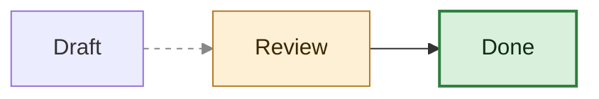
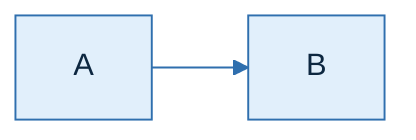

# Styling diagrams in Obsidian (mermaid.js today, Pele next)

Verified on Obsidian 1.14.4 (mermaid 11.13.0) on 2026-10-19. Pele facts are from obsidianmd/pele 1.6.0.

## Contents
1. How colour works in each engine
2. Pick by intent
3. In-diagram styles and what Pele keeps
4. Styling support by diagram type
5. A palette that reads everywhere
6. Mermaid themes (today only)
7. CSS snippets (today and Pele)

## 1. How colour works in each engine

| | mermaid.js in Obsidian today | Pele |
|---|---|---|
| Base look | Mermaid's `default` light theme, always | `--pele-*` CSS variables |
| Dark mode | Obsidian **inverts the whole SVG**: `.theme-dark .mermaid > svg { filter: invert(100%) hue-rotate(180deg) saturate(1.25) }` | The variables follow the theme; no inversion |
| `style` / `classDef` colours | Applied, then inverted in dark mode | Applied exactly as written, never inverted |
| `theme` / `themeVariables` | Applied, then inverted in dark mode | Ignored silently |
| Fonts | `--font-mermaid` (Obsidian sets it) | `--pele-font`, `--pele-font-mono` |

What that means in practice:
- **No colours at all = follows light/dark on both engines.** That's the right default when the user says "match my theme".
- **Never set `theme: dark` in Obsidian.** Dark mode inverts it back to near-light, and light mode shows it dark, so it ends up wrong in both.
- **Design inline colours for light mode:** light fill, mid-tone stroke, dark `color:`. Today's dark mode inverts that into a dark fill with light text in roughly the same hue. Under Pele it stays a light box with dark text, which still reads on a dark page. Dark or saturated fills invert into muddy pastels.
- **Exact brand colours only survive in light mode today.** Say so if the user cares about exact hex values.

## 2. Pick by intent

| The user wants | mermaid.js today | Pele |
|---|---|---|
| Follow light/dark | No colours | Same |
| Colour by meaning (ok/warn/risk) | `classDef` with the palette in §5 | Same `classDef` (allowed properties only) |
| Highlight one node | `style id …` or `id:::class` | Same, or CSS `.pele-node[data-id="id"]` |
| Edge colour or dashes | `linkStyle 0 stroke:#…,stroke-dasharray:4 4` | Same |
| Palette for one diagram | `theme: base` + `themeVariables` (inverted in dark) | `--pele-*` in a snippet (vault-wide) |
| Palette for the whole vault | No clean option (no global Mermaid config in Obsidian) | `assets/pele-theme.css` snippet |
| Chart/series colours | `themeVariables` `pie1…pie12`, `cScale0…` | `--pele-series-1..8` |
| Fonts | `body { --font-mermaid: … }` snippet | `--pele-font` snippet |
| Hand-drawn or modern look | `look: handDrawn` / `neo` → `looks-and-layout.md` | Ignored; Pele has one clean style |

## 3. In-diagram styles and what Pele keeps


- `classDef default …` styles every node. `class A,B name` and `A:::name` apply classes.
- Never call a class `style`, `class`, `end`, … These are reserved and fail to parse. This vault had 11 diagrams broken by `classDef style`.
- **Pele keeps only:** `fill`, `fill-opacity`, `stroke`, `stroke-width`, `stroke-dasharray`, `stroke-dashoffset`, `stroke-linecap`, `stroke-linejoin`, `stroke-opacity`, `opacity`, `rx`, `ry`, `color`, `font-size`, `font-family`, `font-weight`, `font-style`, `text-decoration`, `letter-spacing`, `word-spacing`.
- It drops everything else (`padding`, `background`, `border-radius`, `width`, …) plus `!important`, and any value containing `url(`, `;`, `{ }`, `<`, `>` or `javascript:`.
- Always pair `fill` with `color`. Otherwise the text colour comes from the theme and can vanish against your fill.

## 4. Styling support by diagram type

| Type | In-diagram styling |
|---|---|
| flowchart, swimlane, agentflow | `style`, `classDef` (+`default`), `class`, `:::`, `linkStyle N\|default`, per-edge `interpolate` |
| class | `style`, `classDef`, `cssClass`, `:::` |
| state | `classDef`, `class`, `:::`, `style` |
| er, requirement, block, usecase | `style`, `classDef`, `class` (+`:::` except block) |
| sequence | `box <colour> … end`, `rect <colour> … end`: translucent `rgba()/hsla()` (alpha 0.15–0.3), **no hex** (silently dropped). Opaque light tints go light-on-light under Pele dark mode, because the text follows the theme |
| gantt | Task tags `crit`, `active`, `done`, `milestone`; `todayMarker <css>\|off` |
| c4 | `UpdateElementStyle(id, $bgColor, $borderColor, $fontColor)`, `UpdateRelStyle(…, $textColor, $lineColor)` |
| quadrant | `classDef` + `Point:::name`; inline `radius`, `color`, `stroke-color`, `stroke-width` only |
| treemap | `classDef` + `:::` on rows |
| venn | `style A fill:…, color:…` |
| mindmap, kanban, treeView | `:::` adds a class name only; no visible effect without CSS |
| pie, xychart, radar, sankey, packet, gitGraph, timeline, journey, ishikawa, cynefin, wardley, railroad, eventmodeling | None: colours come from the theme (Pele: `--pele-series-*`) |

## 5. A palette that reads everywhere

Light fill, mid stroke, dark text. It reads in light mode, in today's inverted dark mode, and under Pele:

| Class | fill | stroke | color |
|---|---|---|---|
| ok | `#d8f0dc` | `#2f7d3e` | `#0f2e15` |
| warn | `#fdf0d5` | `#b7791f` | `#3b2600` |
| risk | `#fbe1e1` | `#c0392b` | `#3d0b07` |
| info | `#e1effb` | `#2f6fae` | `#0d2740` |
| neutral | `#eeeeee` | `#777777` | `#222222` |
| accent | `#ece4fb` | `#7048c0` | `#241345` |

The user's own diagrams already follow this pattern (e.g. `fill:#E0F7FA,stroke:#4FC3D9,color:#0B2E33`), so match it when adding to their notes.

For a brand colour, use it as the **stroke**, with a pale tint of it as the fill. A saturated brand fill inverts badly in dark mode. Where you can't set the text colour (sequence `rect`/`box`, subgraph backgrounds), use a translucent `rgba()` tint instead of an opaque pale fill.

When the user asks to "match the theme" on a diagram that already uses this palette, keep their classes. They already work in both modes.

## 6. Mermaid themes (today only)

The built-in themes are `default`, `neutral` (good for greyscale or print), `dark` (don't use; see §1), `forest`, and `base`. `base` is the only theme that takes `themeVariables` reliably.


- Prefer frontmatter `config:` over `%%{init: {"theme": "base"}}%%`. It's easier to read, and both engines parse either form.
- Themes are per diagram. Obsidian has no vault-wide Mermaid config.
- Pele ignores `theme`/`themeVariables`, so the diagram falls back to the vault's `--pele-*` colours. The diagram still works; it just stops being custom.

## 7. CSS snippets

- Snippets live in `<vault>/.obsidian/snippets/<name>.css`.
- `obsidian snippets` lists them and `obsidian snippet:enable name=<name>` turns one on.
- Enabling one changes how every note looks, so confirm with the user first. Writing the file on request is fine.

**Today (mermaid.js):**
```css
/* Diagram font */
body { --font-mermaid: var(--font-text); }

/* Exact colours in dark mode: turn off Obsidian's inversion.
   Then every diagram must carry dark-friendly colours, or the default theme shows as a bright box. */
.theme-dark .mermaid > svg { filter: none; }
```
Targeting Mermaid's internal SVG classes (`.mermaid .node rect`, …) works but breaks easily, and Pele uses different class names. Avoid it.

**Pele (once Obsidian ships it):** `assets/pele-theme.css` maps the `--pele-*` variables onto Obsidian's theme variables, so diagrams follow any community theme and light/dark.
- It has no effect until Pele ships, and Obsidian may provide its own mapping. Treat it as the customisation point.
- Variables: `--pele-bg`, `--pele-fg`, `--pele-muted`, `--pele-line`, `--pele-surface`, `--pele-surface-alt`, `--pele-border`, `--pele-accent`, `--pele-critical`, `--pele-error`, `--pele-font`, `--pele-font-mono`, `--pele-title-weight`, `--pele-heading-weight`, `--pele-bold-weight`, `--pele-radius`, `--pele-series-1..8`.
- Class hooks: `.pele` (root svg), `.pele-<type>` (e.g. `.pele-flowchart`), `.pele-title`, `.pele-node`, `.pele-edge`, `.pele-edge-label`, `.pele-cluster`, `.pele-cluster-label`, `.pele-label`, `.pele-marker`, `.pele-icon`.
- Target one node by its source id: `.pele-node[data-id="start"] .pele-label { fill: var(--pele-accent); }`.
