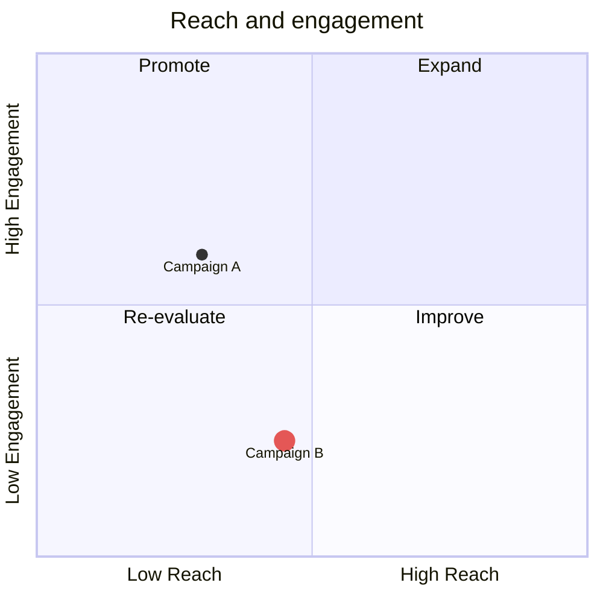
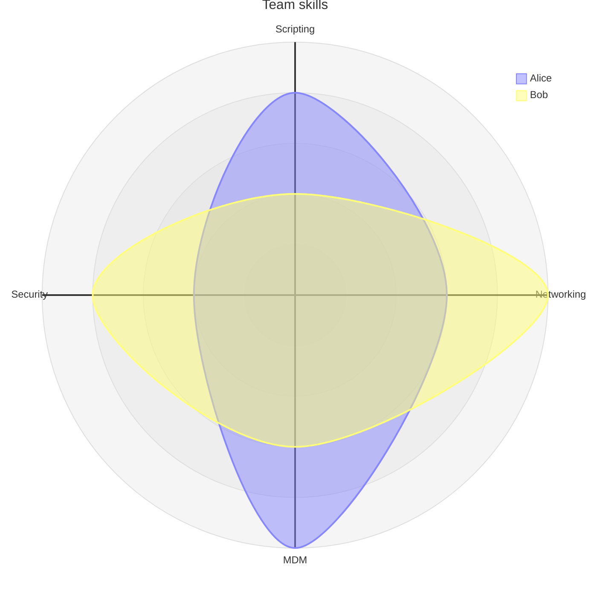
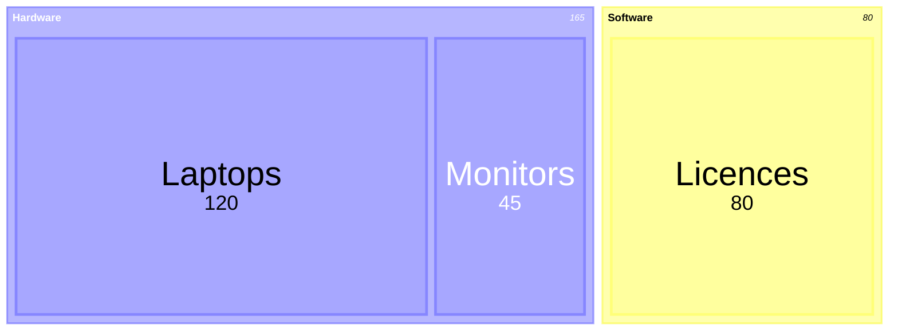
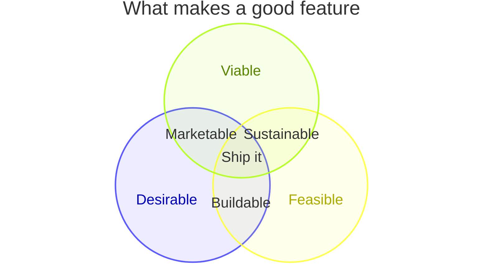

# Chart types: pie, xychart, quadrant, sankey, radar, treemap, venn

Facts as of Pele 1.6.0 / Mermaid 12.1 / Obsidian 1.14.4 (mermaid 11.13), checked 2026-10-19.
Examples adapted from Mermaid's docs (MIT) via Pele's test corpus.

Chart colours never come from inline styles. They come from the theme today, and from `--pele-series-1..8` under Pele, repeating after 8 categories. Treemap, venn and quadrant points are the exceptions below.

## pie: renders today ✓

`pie showData` then `title X`, then `"Label" : value` lines.
Config `pie.donutHole`, `legendPosition` and `highlightSlice` are Mermaid 11.16+. On 11.13 they're silently ignored, and Pele never reads `highlightSlice`.

## xychart / xychart-beta: renders today ✓

- Axes: `x-axis [a, b, c]` or `x-axis "Label" 0 --> 100`; `y-axis "Label" min --> max`.
- Series: `bar [..]`, `line [..]`. `xychart horizontal` flips the orientation.
- **Breaks today:** legends for named series, per-point labels and rotated x labels (11.16+/11.17+). Keep series unnamed.

## quadrantChart: renders today ✓

- Point styles allow only `radius`, `color` (hex), `stroke-color` (hex) and `stroke-width` (px). Any other key is an error under Pele.
- `classDef` plus `Point:::name` also works.

## sankey / sankey-beta: renders today ✓

CSV rows `source,target,value`. Quote any field that contains a comma.
Config `nodeColors`, `nodeWidth`/`nodePadding` and outlined labels are 11.15+, so they're silently ignored on 11.13. `sankey.showValues`, `prefix` and `suffix` work on both.

## radar-beta: renders today ✓

## treemap / treemap-beta: renders today ✓

Indentation gives the hierarchy, and leaves carry values. `classDef` plus `:::name` on rows works.

## venn-beta: renders today ✓ (11.13)

Optional set sizes: `set A["Alpha"]:20`. Styling: `style A fill:#…, color:#…`.
