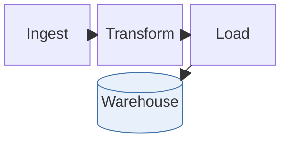

# Flow types: flowchart, swimlane, agentflow, block

Facts as of Pele 1.6.0 / Mermaid 12.1 / Obsidian 1.14.4 (mermaid 11.13), checked 2026-10-19.
Refresh from pele.run/compatibility and the Mermaid CHANGELOG when Obsidian ships Pele.
Examples adapted from Mermaid's docs (MIT) via Pele's test corpus.

## flowchart / graph: renders today ✓

You know this syntax. What matters here:

- **Reserved words.** `end`, `style`, `class`, `classDef`, `linkStyle`, `click`, `subgraph` can't be node ids or class names. `classDef style …` / `:::style` broke 11 diagrams in this vault (fixed 2026-10-19). Capitalise (`End`) or rename to a word that doesn't start with a keyword (`guide`). Older renderers, such as the Confluence app, can trip on `styleX`/`endX` ids.
- **Special characters in labels.** Brackets, parentheses, `#`, `;` or quotes inside a label need the whole label in double quotes: `A["Start (draft)"]`. Use `#quot;` for a literal quote.
- **Ids starting with `o` or `x` right after a link** (`A---oB`) become circle/cross edges. Add a space or rename.
- **Line breaks** use `<br>` (both engines). For emphasis use `<b>`/`<i>` or markdown strings ``"`**bold** text`"``. Other HTML is stripped by Pele.
- **Note links.** `class A,B internal-link;` makes nodes open the note named by their *label*. Avoid `:` in a linked label (it reads as a URL scheme). `A[[X]]` is a subroutine shape, not a wikilink.
- **Newer syntax that breaks today:**
  - shapes `datastore` (11.15), `folder`/`bucket`/`console`/`browser`/`person` (11.17);
  - `@{ view: collapsed }` subgraphs (11.17).

  `A@{ shape: … }` with older shapes (rect, rounded, diamond, cyl, doc, …) is fine on 11.13.
- **Config both engines read:** `flowchart.curve` (`basis`, `linear`, `step`…), `nodeSpacing`, `rankSpacing`, `wrappingWidth`, `inheritDir`.
- **Pele layout difference:** a subgraph keeps its own `direction` even when its nodes link outside it. Mermaid ignores the subgraph direction in that case.
- **Styling:** `style`, `classDef` (incl. `default`), `class`, `:::`, and `linkStyle N|default`. See `../styling.md`.

## swimlane-beta: Pele only (Mermaid 11.16+)

This is flowchart syntax where each top-level subgraph is a lane. A `direction` set inside a lane is ignored.

```mermaid
swimlane-beta LR
  subgraph Customer
    Browse[Browse catalogue]
    Pay[Pay]
  end
  subgraph Warehouse
    Pick[Pick items]
    Ship[Ship order]
  end
  Browse --> Pay --> Pick --> Ship
```
**Fallback today:** `flowchart LR` with the same subgraphs. It renders on both engines; the lanes are just boxes.

## agentflow-beta: Pele only (Mermaid 12.0+)

Agent and tool pipelines:
- **Shapes** (`@{ shape: … }`): `input`, `task`, `tool`, `decision`, `refdoc`, `action`.
- **Containers:** `flow id["Label"] … end`, `global … end`, `connector`.

```mermaid
agentflow-beta LR
  brief["Brief"]@{ shape: input }
  draft["Draft copy"]@{ shape: task }
  spellcheck["spell_check"]@{ shape: tool }
  guide["Style guide"]@{ shape: refdoc }
  publish["Publish"]@{ shape: action }
  brief --> draft --> spellcheck --> publish
  draft -.- guide
```
**Fallback today:** a flowchart with `([input])`, `[task]`, `[[tool]]`, `{decision}`, `[/refdoc/]` and `>action]` shapes.

## block / block-beta: renders today ✓

Grid layout you place by hand (`columns N`, `space`, nested `block:id … end`, arrows `<["label"]>(down)`). Styling: `style`, `classDef`, `class`.


