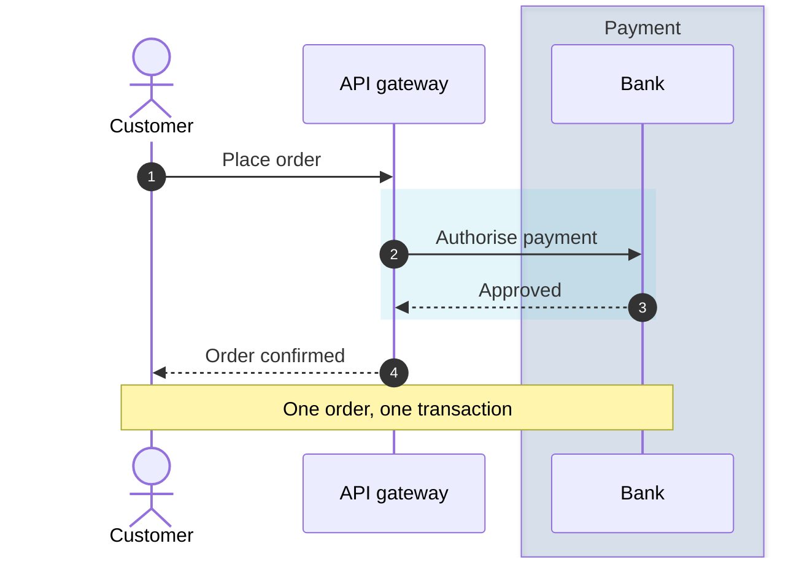
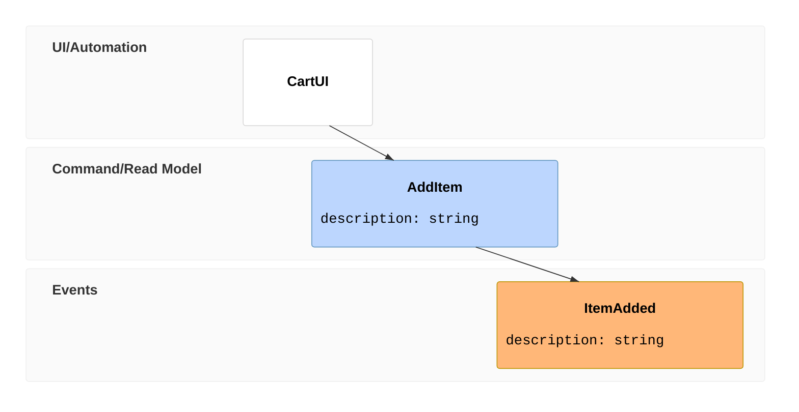

# Interaction types: sequence, state, journey, use case, event modeling

Facts as of Pele 1.6.0 / Mermaid 12.1 / Obsidian 1.14.4 (mermaid 11.13), checked 2026-10-19.
Examples adapted from Mermaid's docs (MIT) via Pele's test corpus.

## sequenceDiagram: renders today ✓

- **Colouring** groups uses `box <colour> Title … end` (participants) and `rect <colour> … end` (message ranges). Use `rgba()`/`hsla()`, translucent, around alpha 0.15–0.3.
  - **A hex colour parses but is silently dropped** (verified on 11.13), and `box #hex Title` also loses its title. Pele has the same limit.
  - **Avoid opaque tints.** Message and participant text can't be coloured and follows the theme. Under Pele's dark mode, a light opaque tint like `rgb(232,241,251)` puts light text on a light band.
  - For a brand hex, convert it: `#4FC3D9` becomes `rgba(79,195,217,0.2)`.
- **Numbering:** `autonumber` works. Decimal or stepped numbering (1.1, 1.2) is Mermaid 11.15+, so it breaks today. Write the numbers into the message text instead (`A->>B: 1.1 Request`).
- **Line breaks** in messages and notes use `<br>`. `%%{wrap}%%` or `config: sequence: wrap: true` wraps long text.
- **Config both engines read:** `sequence.mirrorActors`, `rightAngles`, `actorMargin`, `messageAlign`, `showSequenceNumbers`, `hideUnusedParticipants`, `wrap`.
- **No `style`/`classDef`.** Participant colours come from the theme.



## stateDiagram-v2: renders today ✓

- Composite states use `state X { … }`. Choice, fork and join use `state c <<choice>>` / `<<fork>>` / `<<join>>`. Notes: `note right of X … end note`.
- Styling: `classDef`, `class`, `:::`, `style`. `click` links work.
- Config: `state.nodeSpacing`, `rankSpacing`, `wrappingWidth` (wrapping options for state are Mermaid 12.0+ only; skip them).

## journey: renders today ✓

`title`, `section`, and `Task: score 1–5: Actor, Actor`. No inline styling: section colours come from the theme (Pele: `--pele-series-*`).

## usecase-beta: Pele only (Mermaid 12.0+)

```mermaid
usecase-beta
direction LR
actor Customer
actor Support
systemBoundary Storefront
  Browse("Browse catalogue")
  Checkout("Checkout")
end
Customer --> Browse
Customer --> Checkout
Support --> Checkout
Checkout ..> : include Browse
```
- Relations: `..> : include X`, `..> : extend X`, `--|>`. Styling: `style`, `classDef`, `class`, `:::`.
- **Fallback today:** `flowchart LR` with actors as `([Customer])`, the boundary as a `subgraph`, and use cases as `(Browse catalogue)`.

## eventmodeling: Pele only (Mermaid 11.15+)

- Frames: `tf <id>` (time frame) and `rf <id>` (reset frame).
- Entity kinds: `ui`, `cmd`, `evt`, `rmo` (read model) and `pcr` (processor), each with optional `{ field: type }`.
- Data references use `[[DataRef]]`. Here that is a *data reference*, not a wikilink.


**Fallback today:** `flowchart LR` with one subgraph per lane (UI / Commands / Events / Read models), ordered left to right.
