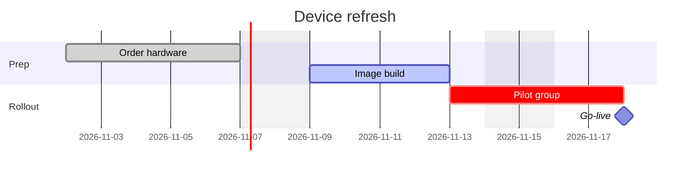
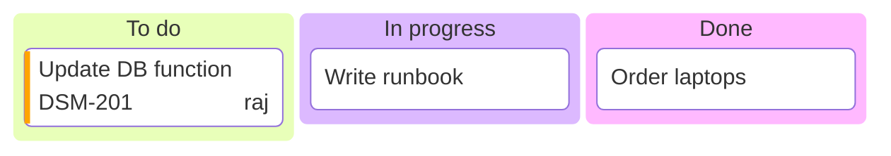

# Planning types: gantt, timeline, kanban, git graph

Facts as of Pele 1.6.0 / Mermaid 12.1 / Obsidian 1.14.4 (mermaid 11.13), checked 2026-10-19.

## gantt: renders today ✓

- Basics: `dateFormat YYYY-MM-DD`, `axisFormat %d %b`, `excludes weekends`, `section`, and tasks `Name :tag, id, start, duration|end`.
- **Tags:** `crit` (Pele colours it `--pele-critical`), `active`, `done`, `milestone`. Dependencies: `after id`.
- **Breaks today:** more than one `excludes`/`includes` line (Mermaid 11.16+). Put everything on one line.
- `todayMarker off` or `todayMarker stroke:#…` controls the today line. `click id href "https://…"` adds links.
- **Config both engines read:** `gantt.barHeight`, `barGap`, `topAxis`, `axisFormat`, `tickInterval`, `weekday`, `displayMode: compact`.

## timeline: renders today ✓

- Structure: `title`, `section`, and `Period : event : event`. Line breaks use ` `.
- A direction after the keyword (`timeline LR`) is Mermaid 11.14+. On 11.13 it parses but is ignored.
- `timeline.disableMulticolor: true` makes all sections one colour.
- No inline styling.

## kanban: renders today ✓

- Indentation defines columns and cards.
- Metadata goes in `@{ ticket, assigned, priority }`. `config: kanban: ticketBaseUrl: 'https://…/#TICKET#'` links the tickets.
- `:::class` has no visible effect without CSS.

## gitGraph: renders today ✓

- Commands: `commit id: "x" tag: "v1"`, `branch name`, `checkout name`, `merge name`, `cherry-pick id: "x"`.
- Config: `gitGraph.mainBranchName`, `showBranches`, `showCommitLabel`, `rotateCommitLabel`, `parallelCommits`.
- Branch colours come from the theme (Pele: `--pele-series-*`).
