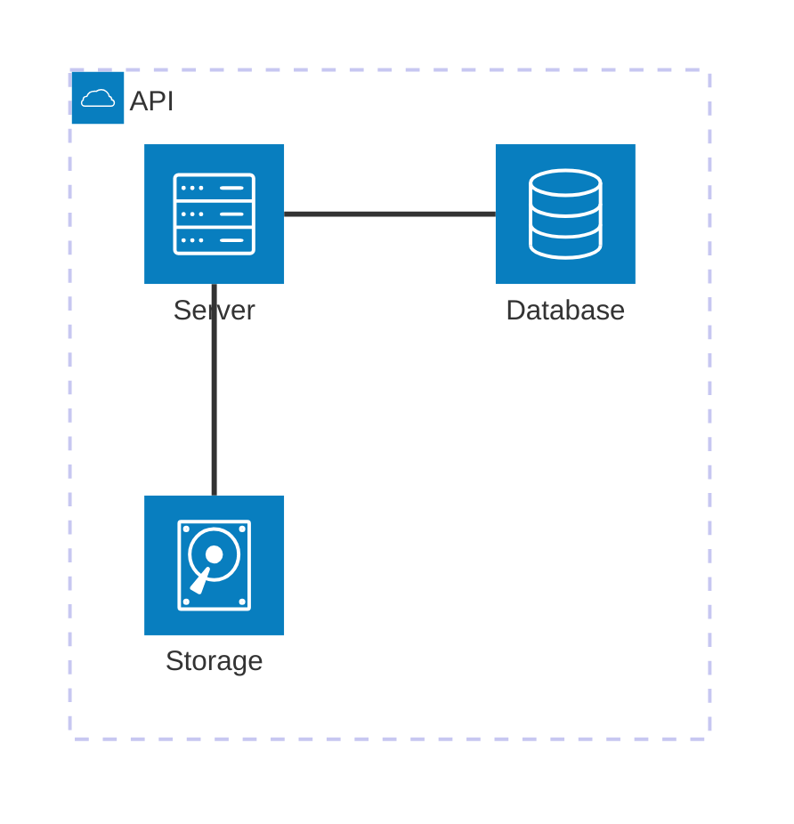
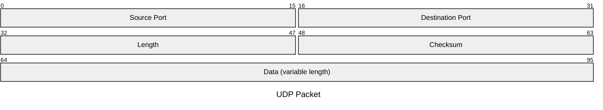

# Structure types: class, ER, requirement, C4, architecture, packet, tree view

Facts as of Pele 1.6.0 / Mermaid 12.1 / Obsidian 1.14.4 (mermaid 11.13), checked 2026-10-19.
Examples adapted from Mermaid's docs (MIT) via Pele's test corpus.

## classDiagram: renders today ✓

- Generics use tildes: `List~int~`. Annotations: `<<interface>>`. Notes: `note for X "text"`.
- **Breaks today:** nested or dotted namespaces (`namespace a.b`, Mermaid 11.15+). Use flat `namespace Name { … }`.
- Styling: `style`, `classDef`, `cssClass "A,B" name`, `:::`. Config: `class.hideEmptyMembersBox`, spacing.

## erDiagram: renders today ✓

- Relationship cardinality: `||--o{`, `}|..|{` and so on. Attributes go in `ENTITY { type name PK "comment" }`.
- **Breaks today:** optional attribute types (`string? name`) and ER subgraphs (Mermaid 11.16/11.17).
- Styling: `style`, `classDef`, `class`, `:::`. Under Pele, `internal-link` on an entity turns it into a note link.

## requirementDiagram: renders today ✓

- Element types: `requirement` / `functionalRequirement` / … `name { id: … text: … risk: … verifymethod: … }`, and `element name { type: … }`.
- Relations: `a - satisfies -> b`, `contains`, `traces`, `derives`, `refines`, `verifies`, `copies`.
- Styling: `style`, `classDef`, `class`, `:::`.

## C4 (C4Context / C4Container / C4Component / C4Dynamic / C4Deployment): renders today ✓

- Elements: `Person()`, `System()`, `Container()`, `Component()`, `*_Boundary(…) { }`, `Rel(a, b, "label", "tech")`.
- Styling: `UpdateElementStyle(id, $bgColor, $borderColor, $fontColor)` and `UpdateRelStyle(a, b, $textColor, $lineColor, $offsetX, $offsetY)`.
- Layout: `UpdateLayoutConfig($c4ShapeInRow, $c4BoundaryInRow)`. Config keys are ignored by Pele.

## architecture-beta: renders today ✓


- **Icons:** the built-in icons are `cloud`, `database`, `disk`, `internet` and `server`. Any other icon name (`logos:aws`, …) needs an icon pack, and Obsidian registers none, so it shows a blank box.
- **Breaks today:** `align row|column` (Mermaid 11.16+).

## packet / packet-beta: renders today ✓


- `+16: "Field"` (relative width) also works on 11.13. The `packet.bitOrder` config is Mermaid 12.1+.
- No inline styling.

## treeView-beta: Pele only (Mermaid 11.14+)


- Indentation also works in place of box-drawing characters (box-drawing input needs 11.16+). `## text` adds a description; `:::highlight` emphasises a row.
- **Fallback today:** for file trees, a plain ` ```text ` code block with the same box-drawing characters is clearer than any diagram. For concept trees, use `mindmap`.
