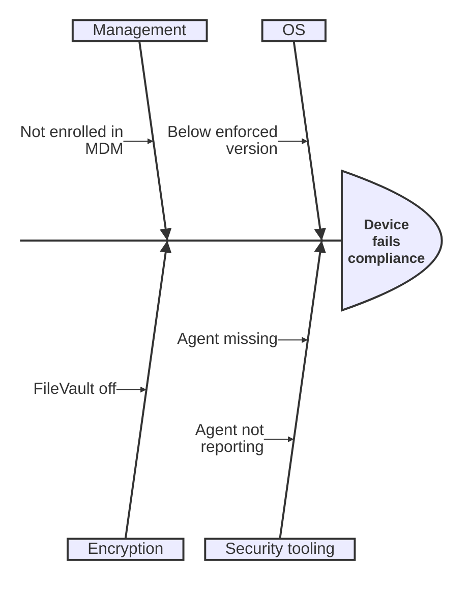

# Thinking types: mindmap, ishikawa, cynefin, wardley, railroad

Facts as of Pele 1.6.0 / Mermaid 12.1 / Obsidian 1.14.4 (mermaid 11.13), checked 2026-10-19.
Examples adapted from Mermaid's docs (MIT) via Pele's test corpus.

## mindmap: renders today ✓

- Indentation gives the hierarchy. Node shapes: `root((circle))`, `[square]`, `(rounded)`, `))bang((`, `{{hexagon}}`. Line breaks use `<br>`.
- `::icon(fa fa-book)` needs an icon font. Obsidian loads none, so the icon is blank. Skip icons.
- `:::class` has no visible effect without CSS. Branch colours come from the theme.

## ishikawa / ishikawa-beta (fishbone): renders today ✓ (11.13)

The first line is the effect. Categories follow, then indented causes (nested causes allowed).


No inline styling.

## cynefin-beta: Pele only (Mermaid 11.16+)

```mermaid
cynefin-beta
  title Strategy Categorization

  complex
    "Market research"

  complicated
    "Competitive analysis"

  clear
    "Standard pricing"

  chaotic
    "Crisis management"

  complex --> complicated : "Pattern identified"
```
- Domains: `complex`, `complicated`, `clear`, `chaotic`, `confusion`. Movement between them: `a --> b : "label"`.
- **Fallback today:** a `quadrantChart` with quadrant-1 complex, quadrant-2 complicated, quadrant-3 clear and quadrant-4 chaotic, with items as points. Mention "confusion" (the centre) in prose. Quadrant charts can't draw the movement arrows.

## wardley-beta: Pele only (Mermaid 11.14+)

```mermaid
wardley-beta
title Tea Shop Value Chain

anchor Business [0.95, 0.63]
component Cup of Tea [0.79, 0.61]
component Tea [0.63, 0.81]
component Hot Water [0.52, 0.80]
component Kettle [0.43, 0.35]

Business -> Cup of Tea
Cup of Tea -> Tea
Cup of Tea -> Hot Water
Hot Water -> Kettle

evolve Kettle 0.62
note "Standardising power lets kettles evolve faster" [0.30, 0.49]
```
- Coordinates are `[visibility, evolution]`, both 0–1.
- More syntax: `pipeline X { }`, `(build|buy|outsource)` markers, `size [w,h]`.
- **Fallback today:** a `quadrantChart`.
  - x-axis: `Genesis --> Commodity`; y-axis: `Invisible --> Visible`.
  - Points: `Name: [evolution, visibility]`. **Swap the order:** Wardley uses `[visibility, evolution]`, but quadrant uses `[x, y]`.
  - Label the quadrants Genesis / Custom / Product / Commodity.
  - It can't draw dependencies. Say so, and add a small `flowchart TD` value chain if the links matter.

## railroad-beta / railroad-ebnf-beta / railroad-abnf-beta / railroad-peg-beta: Pele only (Mermaid 11.16+)

Grammar or syntax diagrams from EBNF, ABNF or PEG rules.

```mermaid
railroad-ebnf-beta
title "Optional Sign"

sign = "+" | "-" ;
number = sign? digit+ ;
digit = "0" | "1" | "2" | "3" | "4" | "5" | "6" | "7" | "8" | "9" ;
```
**Fallback today:** keep the grammar in a ` ```ebnf ` code block. A flowchart imitation of a railroad diagram is rarely worth it.
